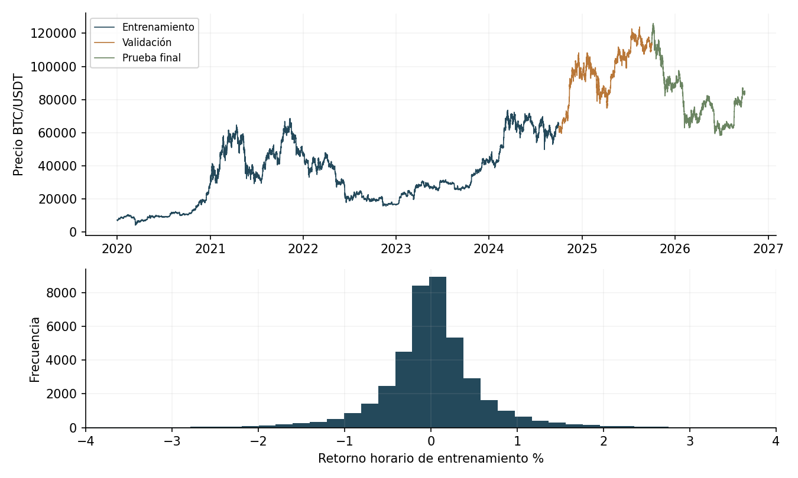
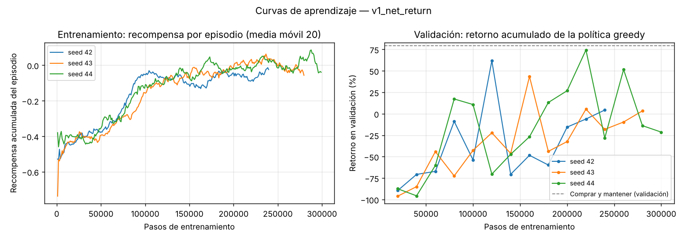
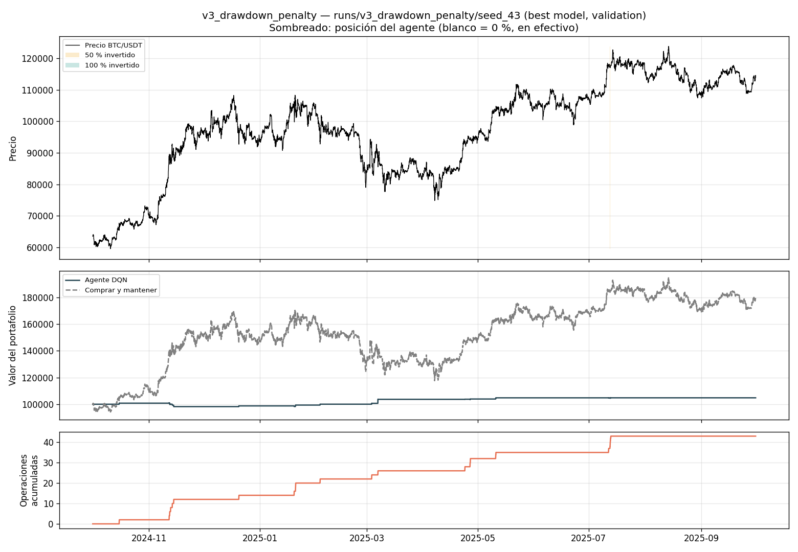
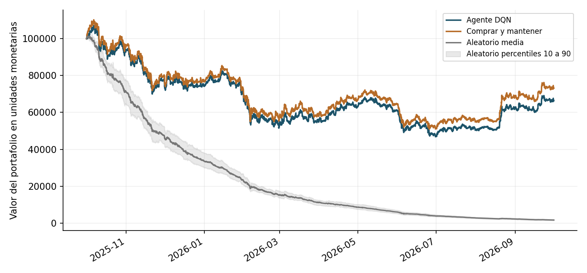
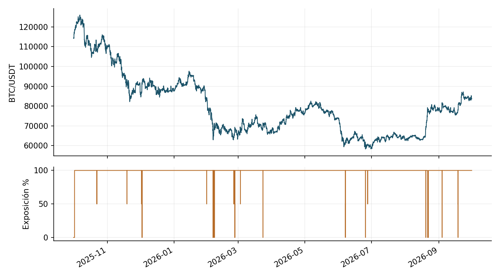
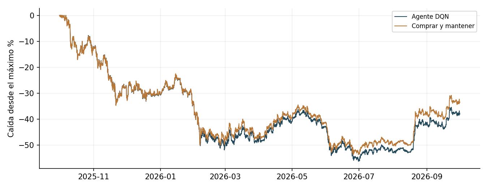

# Agente inversor con aprendizaje por refuerzo

Proyecto académico que estudia si un agente DQN puede aprender una estrategia de
inversión en BTC/USDT y generalizar a un período posterior al entrenamiento. En
cada hora decide mantener el 0 %, 50 % o 100 % del patrimonio en el activo.

La prueba final produjo un retorno de **−33,67 %** para el agente y **−26,87 %**
para comprar y mantener. El agente no superó esta referencia y tuvo una caída
máxima mayor. El proyecto analiza ese resultado junto con los costos, la
exposición y las limitaciones metodológicas.

El trabajo se organiza por actividades siguiendo el enunciado: datos, formulación,
entorno, algoritmo, recompensa, evaluación, discusión y reproducibilidad.
Este README contiene la documentación principal de la entrega. Los análisis
detallados, el código, los datos, los modelos y los resultados se enlazan desde
cada actividad; no se requiere un informe Word para consultar el trabajo.

## Contenido

1. [Instalación y estructura](#instalación-y-estructura)
2. [Datos y análisis exploratorio](#datos-y-análisis-exploratorio)
3. [Formulación del estado y las acciones](#formulación-del-estado-y-las-acciones)
4. [Entorno y costos](#entorno-y-costos)
5. [Agente y entrenamiento](#agente-y-entrenamiento)
6. [Diseño e iteración de la recompensa](#diseño-e-iteración-de-la-recompensa)
7. [Baselines y métricas](#baselines-y-métricas)
8. [Selección y protocolo de evaluación](#selección-y-protocolo-de-evaluación)
9. [Resultados e interpretación](#resultados-e-interpretación)
10. [Discusión y reflexión individual](#discusión-y-reflexión-individual)
11. [Reproducción y verificación](#reproducción-y-verificación)
12. [Cobertura de los requisitos y fuentes](#cobertura-de-los-requisitos-y-fuentes)

## Instalación y estructura

Se requiere Python 3.11, 3.12 o 3.13. Ejecute los comandos desde la carpeta que
contiene este README y `pyproject.toml`.

```bash
python -m venv .venv
```

Active el entorno según el sistema:

```powershell
# Windows PowerShell
.\.venv\Scripts\Activate.ps1
```

```bash
# macOS o Linux
source .venv/bin/activate
```

Instale las dependencias fijadas:

```bash
python -m pip install --upgrade pip
python -m pip install -e .
```

La evaluación incluida se ejecutó con Python 3.12.14, NumPy 2.1.3, pandas 2.2.3,
Gymnasium 1.4.0, Stable-Baselines3 2.9.0 y PyTorch 2.14.1 en CPU. El registro
completo está en [execution.json](results/held_out/execution.json).

```text
ProyectoFinal_RL/
├── data/                       Datos originales y derivado causal
├── notebooks/eda.ipynb          Análisis exploratorio e interpretaciones
├── configs/
│   ├── project.toml             Activo, datos, fechas y semilla global
│   └── dqn.toml                 Hiperparámetros y entrenamiento
├── src/
│   ├── data.py                 Carga, calidad y particiones
│   ├── download_data.py        Descarga del dataset
│   ├── prepare_data.py         Tratamiento causal de huecos
│   ├── features.py             Indicadores y escalamiento
│   ├── environment.py          Simulación de inversión
│   ├── env_factory.py          Integración de datos y entorno
│   ├── agent.py                Agente DQN
│   ├── train.py                Entrenamiento y validación
│   ├── rewards.py              Versiones de recompensa
│   ├── analysis.py             Conducta y comparación en validación
│   ├── reward_report.py        Comparación de checkpoints
│   ├── sensitivity.py          Sensibilidad a hiperparámetros
│   ├── baselines.py            Comprar y mantener y agente aleatorio
│   ├── metrics.py              Métricas financieras
│   ├── freeze_evaluation.py    Congelamiento del protocolo
│   └── evaluate.py             Evaluación y trazabilidad
├── tests/                      Pruebas de funcionamiento
├── runs/                       Corridas originales y sus modelos
├── models/final/               Modelo y protocolo congelados
├── results/                    Métricas, trayectorias y ejecución
├── docs/                       Informes por actividad y figuras
├── pyproject.toml
└── README.md
```

## Datos y análisis exploratorio

### Dataset

Se usa BTC/USDT spot de Binance, con velas de una hora, desde el 1 de enero de
2020 hasta el 1 de octubre de 2026, fecha final exclusiva. La descarga se realiza
mediante [Gym Trading Environment](https://gym-trading-env.readthedocs.io/en/latest/download.html).

El archivo original es `data/binance-BTCUSDT-1h.pkl`. Contiene las columnas
`timestamp`, `open`, `high`, `low`, `close` y `volume`. Las fechas se interpretan
en UTC. El archivo derivado es `data/binance-BTCUSDT-1h-interpolated.pkl`.

Los archivos están incluidos para conservar exactamente los datos utilizados.
Una nueva descarga puede cambiar la cobertura y no garantiza reproducir el
experimento histórico. Si se necesita preparar el proyecto desde los datos
originales, la secuencia es:

```bash
# Solo si no se dispone del archivo original conservado
python -m src.download_data

# Construir el derivado causal
python -m src.prepare_data
```

La fuente de Binance debe ser aceptada por la asignatura si se exige el dataset
común del profesor; el enunciado suministrado recomienda utilizar ese dataset.

### Calidad y partición temporal

`src/data.py` comprueba columnas, duplicados, nulos, orden, huecos y coherencia
OHLCV. El dataset original tiene 59.122 filas observadas. Faltan 38 horas del
calendario: seis antes de la primera observación y 32 internas.

Las seis horas iniciales no se imputan. Los huecos internos de hasta cinco horas
se completan causalmente con el último cierre como apertura, máximo, mínimo y
cierre, y volumen cero. Se marcan mediante `is_interpolated=True`. Esta técnica
conserva la frecuencia, pero puede reducir artificialmente la volatilidad durante
el hueco y concentrar el movimiento en la reanudación.

Los cortes están fijados en [configs/project.toml](configs/project.toml):

| Partición | Inicio UTC | Final exclusivo UTC | Uso |
|---|---|---|---|
| Entrenamiento | 2020-01-01; primer dato a las 06:00 | 2024-10-01 | Aprendizaje y ajuste del escalador |
| Validación | 2024-10-01 | 2025-10-01 | Selección de hiperparámetros, recompensa y checkpoint |
| Prueba final | 2025-10-01 | 2026-10-01 | Evaluación del modelo congelado |

Validación y prueba contienen 8.760 precios cada una, equivalentes a 8.759
transiciones dentro de cada partición. El calentamiento de indicadores se
descarta al construir las entradas del entrenamiento.

### Análisis exploratorio

```bash
jupyter notebook notebooks/eda.ipynb
```

El notebook analiza evolución del precio, distribución y colas de los retornos,
volatilidad, tendencias, caídas, volumen, indicadores y diferencias entre períodos.
Los retornos que cruzan interrupciones se excluyen de sus resúmenes horarios.



La serie presenta ciclos de crecimiento y caídas prolongadas. En entrenamiento,
la volatilidad horaria de retornos simples es **0,710 %**, la asimetría es
**−0,44** y la curtosis en exceso es **47,70**. El histograma muestra el centro
entre −4 % y 4 %; también existen observaciones fuera de ese rango. Las colas
amplias indican que la variabilidad no queda bien descrita solo por el retorno
medio. Estos estadísticos excluyen los retornos que tocan velas imputadas.

| Partición | Filas tras completar huecos | Retorno del precio | Media horaria del retorno | Volatilidad horaria |
|---|---:|---:|---:|---:|
| Entrenamiento | 41.634 | +776,43 % | +0,00764 % | 0,710 % |
| Validación | 8.760 | +79,51 % | +0,00787 % | 0,488 % |
| Prueba final | 8.760 | −26,80 % | −0,00246 % | 0,469 % |

El retorno del precio no incluye comisiones y los períodos tienen duraciones
distintas; no son tasas anualizadas. La validación favorece una exposición
prolongada al activo, mientras que el año posterior tiene retorno negativo.
Por ello, una política que parece competitiva en validación puede fallar al
cambiar el mercado. Los valores completos se conservan en
[results/delivery_analysis.json](results/delivery_analysis.json).

Las medias de 24 y 168 horas aportan referencias diaria y semanal. El RSI
describe momentum y la volatilidad distingue períodos de mayor variación.
El volumen tiene valores extremos, de modo que se aplica `log1p`. Estas
decisiones facilitan representar el mercado; no demuestran por sí solas
capacidad predictiva.

**Alcance del período reservado.** El EDA original ya describe el held-out. Por
ello, no se presenta el estudio como una prueba completamente ciega. El código
de entrenamiento no aprende de sus transiciones y la selección registrada se
basa en validación. Después de conocer la prueba final no deben ajustarse modelos
para volver a presentar ese mismo tramo como una evaluación independiente.

## Formulación del estado y las acciones

La red recibe seis variables de mercado, en este orden, y la posición actual:

| Variable | Cálculo | Interpretación |
|---|---|---|
| `return` | Retorno simple de t−1 a t | Movimiento reciente |
| `log_volume` | `log1p(volume)` | Actividad con menor escala extrema |
| `dist_sma_24` | Cierre / media de 24 horas − 1 | Tendencia diaria |
| `dist_sma_168` | Cierre / media de 168 horas − 1 | Tendencia semanal |
| `rsi_scaled` | RSI de 14 horas transformado con `(RSI − 50) / 50` | Momentum |
| `volatility_24` | Desviación de log retornos en 24 horas | Variación reciente |
| Posición | 0, 0,5 o 1, añadida por el entorno | Exposición actual |

`StandardScaler` se ajusta solo con las filas útiles de entrenamiento. Luego se
aplica sin reajuste a validación y prueba. La posición no se estandariza y el
patrimonio no entra en la observación.

Las acciones 0, 1 y 2 representan respectivamente 0 %, 50 % y 100 % del capital.
No se permiten cortos, apalancamiento, diversificación ni otras fracciones.
Esta granularidad permite que DQN produzca un valor por decisión y mantiene
una interpretación económica clara: salir del mercado, participar parcialmente
o mantener exposición completa. A cambio, descarta ajustes como invertir 25 %.

La observación es parcial: los indicadores resumen historia reciente, pero no
contienen toda la información del mercado. Además, el máximo acumulado y el
drawdown del portafolio intervienen en la recompensa sin formar parte del
vector observado. No se afirma, por tanto, que el estado sea plenamente
markoviano.

Los indicadores del agente usan datos hasta el cierre t. La decisión se aplica
al movimiento t a t+1. El EDA desplaza algunos indicadores una vela y ahora
documenta esa diferencia; sus series exploratorias no son las entradas exactas
de la red. La prueba causal usa suficiente historia para verificar las ventanas
largas y cambia precios y volúmenes futuros sin alterar las observaciones previas.

## Entorno y costos

En cada paso de `TradingEnvironment`:

1. Se observa el estado disponible en t y se elige la fracción objetivo.
2. Se calcula `turnover = abs(posición nueva − posición anterior)`.
3. Se descuenta `costo = 0.001 × turnover × patrimonio previo`.
4. Se obtiene `patrimonio siguiente = (patrimonio previo − costo) × (1 + posición nueva × retorno del activo)`.
5. Se actualizan el patrimonio y su máximo, se calcula la recompensa y se avanza.

El capital inicial es 100.000 unidades monetarias. Diez puntos básicos equivalen
a 0,10 % sobre el cambio de exposición. Comprar y mantener paga una entrada de
100 unidades. La recompensa adicional por riesgo o rotación no vuelve a
descontarse del patrimonio como si fuera una comisión.

El simulador supone ejecución al cierre observado, efectivo sin interés y
ausencia de spread, demora, deslizamiento y restricciones de liquidez. Mantener
una fracción intermedia implica un rebalanceo aproximado cuyo costo no se cobra
si la acción no cambia. No hay liquidación forzosa de la posición al final.

## Agente y entrenamiento

Se utiliza DQN estándar de Stable-Baselines3. La arquitectura es
**7 → 64 → 64 → 3**, con ReLU. Se emplean un buffer de 100.000 transiciones, lote
64, tasa de aprendizaje 0,0003 y descuento 0,99.

DQN aproxima el valor de cada acción mediante una red neuronal. En evaluación
elige la acción de mayor valor Q, sin exploración. El buffer permite reutilizar
experiencias y la red objetivo estabiliza los valores usados para entrenar.
Se eligió por el espacio pequeño de acciones discretas; no se entrenó PPO ni
se afirma una superioridad experimental frente a ese algoritmo.

| Hiperparámetro o decisión | Valor |
|---|---|
| Red y activación | 7 entradas → 64 → 64 → 3 salidas; ReLU |
| Optimizador y tasa | Adam; 0,0003 |
| Lote | 64 transiciones |
| Descuento | 0,99 |
| Buffer | 100.000 transiciones |
| Inicio del aprendizaje | Después de 5.000 pasos |
| Frecuencia de actualización | Un gradiente cada 4 pasos |
| Actualización de la red objetivo | Cada 2.000 pasos |
| Norma máxima del gradiente | 10 |
| Exploración | Épsilon de 1 a 0,05 en el primer 30 % de pasos |
| Episodio de entrenamiento | 1.024 pasos; inicio aleatorio |
| Presupuesto | 300.000 pasos |
| Parada anticipada | Seis evaluaciones sin mejora |
| Validación | Cada 20.000 pasos; selección por retorno acumulado |
| Semillas | 42, 43 y 44 |

Las especificaciones completas están en [configs/dqn.toml](configs/dqn.toml).
El protocolo incluye:

- Episodios de 1.024 pasos con inicio aleatorio en entrenamiento.
- Exploración epsilon-greedy de 1 a 0,05 durante el primer 30 % del presupuesto.
- Máximo de 300.000 pasos, o seis evaluaciones sin mejora.
- Validación cada 20.000 pasos y selección del checkpoint por retorno acumulado.
- Semillas de entrenamiento **42, 43 y 44**.

Python, NumPy, PyTorch y el entorno reciben semillas controladas. PyTorch usa un
hilo y algoritmos deterministas cuando están disponibles. Diferencias de
plataforma o versiones pueden cambiar los últimos decimales.

Para repetir un entrenamiento sin reemplazar las corridas conservadas:

```bash
python -m src.train --reward v1_net_return --output-dir runs_reproduccion
```

Para una comprobación corta del flujo:

```bash
python -m src.train --seeds 42 --timesteps 10000 --eval-freq 5000 --output-dir runs_prueba
```

Cada corrida guarda modelos, configuración, curvas, validaciones y metadatos.
El cargador lee la serie completa y calcula indicadores causales; al construir
los entornos de desarrollo se descarta explícitamente held-out. No se usan sus
transiciones para entrenar ni para elegir checkpoints.



Las curvas de las semillas muestran que el rendimiento cambia a lo largo del
entrenamiento. El mejor checkpoint puede ser un pico puntual y no el desempeño
habitual de la política. Por eso se conservan las evaluaciones intermedias y se
comparan también el último checkpoint y la segunda mitad del entrenamiento.
La selección de hiperparámetros, las curvas y su interpretación se desarrollan
en [Algoritmo y entrenamiento](docs/algoritmo_y_entrenamiento.md).

## Diseño e iteración de la recompensa

Las funciones se registran en [src/rewards.py](src/rewards.py):

| Versión | Recompensa |
|---|---|
| `v1_net_return` | Retorno neto de costos |
| `v2_turnover_penalty` | v1 − 0,002 × rotación |
| `v3_drawdown_penalty` | v1 − 1 × profundización del drawdown |
| `v4_drawdown_scaled` | v1 − 0,02 × profundización del drawdown |
| `v5_turnover_drawdown` | v1 − 0,002 × rotación − 0,02 × profundización del drawdown |

La profundización es la parte positiva del empeoramiento del drawdown. El ciclo
de diseño está documentado: proponer v1, entrenar, observar conducta, identificar
problemas, cambiar la recompensa, reentrenar y comparar.

Para reproducir las alternativas con las mismas semillas e hiperparámetros:

```bash
python -m src.train --reward v2_turnover_penalty --output-dir runs_reproduccion
python -m src.train --reward v3_drawdown_penalty --output-dir runs_reproduccion
python -m src.train --reward v4_drawdown_scaled --output-dir runs_reproduccion
python -m src.train --reward v5_turnover_drawdown --output-dir runs_reproduccion

python -m src.analysis compare v1_net_return v2_turnover_penalty v3_drawdown_penalty v4_drawdown_scaled v5_turnover_drawdown --runs-dir runs_reproduccion
python -m src.reward_report --runs-dir runs_reproduccion
```

Para examinar las posiciones de una corrida original en validación:

```bash
python -m src.analysis inspect runs/v5_turnover_drawdown/seed_42
python -m src.analysis inspect runs/v3_drawdown_penalty/seed_43
```

El módulo de análisis bloquea la selección de held-out. La comparación original
está en [runs/comparison](runs/comparison) y la discusión en
[docs/diseno_de_recompensas.md](docs/diseno_de_recompensas.md).

Un resultado relevante es que v3 permanece casi siempre en efectivo: una
penalización muy alta por drawdown reduce la participación. El valor Q positivo
de esa acción no demuestra un error, porque también incluye recompensas de
decisiones futuras.

### Comparación de las versiones en validación

| Versión | Retorno medio | Desviación del retorno | Drawdown medio | Costos medios | Operaciones medias |
|---|---:|---:|---:|---:|---:|
| v1 | +59,8 % | 15,6 pp | −36,2 % | 12.935 | 152 |
| v2 | +59,9 % | 7,1 pp | −34,9 % | 13.172 | 177 |
| v3 | +2,2 % | 3,0 pp | −3,1 % | 3.451 | 48 |
| v4 | +41,4 % | 24,0 pp | −30,1 % | 27.546 | 408 |
| v5 | +88,3 % | 13,9 pp | −30,4 % | 3.986 | 48 |

Se comparan los mejores checkpoints de las semillas 42, 43 y 44; la desviación
es muestral y se expresa en puntos porcentuales. Comprar y mantener obtiene
**+79,3 %** con drawdown **−30,9 %** en este mismo tramo. Estas cifras son de
validación y no deben confundirse con los resultados finales.

El ciclo de diseño queda documentado:

1. **Proponer:** v1 usa el retorno del portafolio neto de costos.
2. **Entrenar:** se ejecutan tres semillas con el protocolo común.
3. **Observar:** la política permanece casi siempre invertida y concentra
   operaciones durante caídas.
4. **Identificar problemas:** la rotación y el riesgo no aportan una mejora
   suficiente frente a comprar y mantener.
5. **Modificar:** v2 penaliza rotación; v3 penaliza drawdown; v4 reduce la escala
   de esa penalización y v5 combina ambas.
6. **Reentrenar:** se mantienen las mismas semillas y condiciones económicas.
7. **Comparar:** v5 mejora retorno y costos frente a v1; v3 reduce el drawdown
   principalmente evitando exposición.

La elección de los mejores checkpoints introduce optimismo: para v5, el último
checkpoint promedia **+24,6 %** y la segunda mitad del entrenamiento **+30,9 %**.
Solo dos de sus 45 evaluaciones superan el +79,3 % del baseline. El +88,3 % de
la tabla no es, por tanto, una estimación estable de rentabilidad futura.

### Comportamiento inesperado



Con v3, los modelos seleccionados permanecen entre **99,4 % y 99,6 %** de
validación en efectivo. El checkpoint ilustrado obtiene aproximadamente
**+4,8 %**, con drawdown **−2,9 %**, pero participa muy poco en un mercado en el
que comprar y mantener gana +79,3 %. El bajo riesgo responde en gran parte a
evitar el mercado y muestra un desajuste entre la recompensa y la intención
de inversión.

En el diagnóstico de entrenamiento, un retorno horario medio cercano a
+0,0074 % es pequeño frente a una profundización media de drawdown de 0,188 %
de la política de referencia. Con coeficiente 1, la penalización puede dominar.
Es una explicación plausible de la inactividad, no una prueba de que estar
siempre en efectivo sea óptimo entre todas las políticas. Las breves entradas
siguen sin una explicación concluyente: pueden reflejar señal aprendida o
pequeñas diferencias de los valores Q sin una ventaja consistente.

## Baselines y métricas

Se implementan dos estrategias de referencia con el mismo entorno:

- **Comprar y mantener:** elige 100 % de exposición durante todo el período.
- **Aleatorio:** elige uniformemente una de las tres acciones. Se conservan las
  veinte semillas **42 a 61**, sin seleccionar la de mejor resultado.

Para ejecutar los baselines en validación:

```bash
python -m src.baselines
```

La salida es `results/validation_baselines/`. Para usar otra carpeta vacía:

```bash
python -m src.evaluate --partition validation --baselines-only --output results/baselines_reproduccion
```

Las métricas de [src/metrics.py](src/metrics.py) son:

| Métrica | Definición |
|---|---|
| Retorno acumulado | Patrimonio final / capital inicial − 1 |
| Máximo drawdown | Mínimo de patrimonio / máximo previo − 1, incluido el capital inicial |
| Costos totales | Suma de comisiones en unidades monetarias |
| Operaciones | Pasos con cambio de fracción, incluida la entrada |
| Exposición | Fracción media y proporción de tiempo en 0 %, 50 % y 100 % |

La media y la desviación muestral del agente aleatorio se calculan a partir de
las métricas de cada trayectoria. No se confunde el promedio de los drawdowns
con el drawdown de una curva promedio.

## Selección y protocolo de evaluación

La recomendación previa, basada en validación, seleccionó
`v5_turnover_drawdown`, semilla 42, por ser la de retorno mediano entre las tres
semillas de esa versión. Dentro de esa corrida se conservó el mejor checkpoint,
correspondiente a 200.000 pasos.

Antes de la prueba final se congelaron los archivos mediante
`src.freeze_evaluation`. El protocolo incluye modelo, configuración, datos,
código y dependencias directas identificados mediante SHA-256. La evaluación de
validación reprodujo exactamente las métricas guardadas del modelo: retorno
91,04 %, drawdown −29,90 % y 38 operaciones.

La entrega ya contiene el modelo congelado en `models/final/` y la evaluación
oficial en `results/held_out/`. **Para reproducirla use el comando de reproducción
de la sección siguiente.** No vuelva a seleccionar una recompensa o semilla a
partir del desempeño final.

La secuencia que generó la evaluación, antes de que existieran esas carpetas, fue:

```bash
python -m src.freeze_evaluation --run runs/v5_turnover_drawdown/seed_42
python -m src.evaluate --partition validation --output results/validation
python -m src.evaluate --partition held_out --output results/held_out
```

Esta secuencia es un registro del procedimiento; no se debe repetir sobre la
entrega existente. El congelamiento no sobrescribe modelos y la evaluación no
sobrescribe carpetas con resultados. `EVALUATION.json` impide una segunda
evaluación oficial accidental.

La evaluación oficial comenzó el **20 de octubre de 2026 a las 13:36:25, hora de
Colombia**, y terminó a las 13:39:00. El commit de origen es
`23c07d0017d581ab7a475d4df1c6515ace3156d1`; las modificaciones locales están
identificadas por las huellas de [PROTOCOL.json](models/final/PROTOCOL.json).

## Resultados e interpretación

Prueba final: del 1 de octubre de 2025 a las 00:00 al 30 de septiembre de 2026 a
las 23:00 UTC. Capital inicial de 100.000 y costo de 10 bps; 8.759 transiciones
por estrategia.

| Estrategia | Retorno | Máximo drawdown | Costos totales | Operaciones | Capital final |
|---|---:|---:|---:|---:|---:|
| DQN congelado | −33,67 % | −56,24 % | 2.429,83 | 53 | 66.332,73 |
| Comprar y mantener | −26,87 % | −53,74 % | 100,00 | 1 | 73.127,03 |
| Aleatorio media | −98,31 % | −98,35 % | 89.503,22 | 5.853,3 | 1.688,38 |
| Aleatorio desviación | 0,24 pp | 0,23 pp | 5.365,36 | 38,3 | 236,32 |

Las desviaciones corresponden a veinte semillas de acciones aleatorias, no a
veinte mercados independientes.



El DQN queda **6,79 puntos porcentuales** por debajo de comprar y mantener.
Además de pagar más comisiones, toma decisiones de exposición que modifican los
retornos capturados. Su rendimiento inferior no puede atribuirse exclusivamente
a los costos. La curva aleatoria muestra el efecto de operar frecuentemente sin
una señal informativa; su banda corresponde a percentiles 10 a 90 entre semillas.



El agente permanece aproximadamente **98,93 %** del tiempo al 100 % de
exposición, **0,31 %** al 50 % y **0,76 %** en efectivo. La política sigue
principalmente al activo y no protege suficientemente el capital durante el
cambio de régimen. En cada trayectoria se separa `decision_time` de
`valuation_time`, porque la decisión en t se valora en t+1.

La exposición media es **99,08 %** y el intervalo más largo sin cambiar de
fracción dura **1.812 horas**. Al cierre, la pérdida monetaria del agente es
**33.667,27** sobre el capital inicial de 100.000. Las 53 operaciones suman
2.429,83 en comisiones, frente a una entrada de 100 para comprar y mantener.
Las comisiones ya están descontadas de los retornos de la tabla.



El máximo drawdown del agente conecta un máximo previo de **107.086,22** con
un mínimo posterior de **46.859,13**, observado el **30 de junio de 2026**.
La caída de −56,24 % supera la de comprar y mantener (−53,74 %). La curva
muestra que la selección favorable en validación no evitó pérdidas
prolongadas en el período posterior.

La media del agente aleatorio termina con **1.688,38** y acumula **89.503,22**
de costos. Su elevada frecuencia de cambios explica por qué operar sin una
señal informativa puede erosionar el capital. Superarlo no basta para afirmar
que el agente aporta valor: la comparación con comprar y mantener es más
exigente y aquí resulta desfavorable al DQN.

Resultados completos:

- [Resumen financiero](results/held_out/summary.csv).
- [Resultados por ejecución](results/held_out/metrics_by_run.csv).
- [Registro y versiones](results/held_out/execution.json).
- [Trayectoria del agente](results/held_out/rl_trajectory.csv).
- [Comparación de recompensas en validación](runs/comparison/reward_comparison.md).

## Discusión y reflexión individual

Las principales limitaciones son:

- No estacionariedad entre el año de validación y el año de prueba.
- Optimismo al seleccionar entre varios checkpoints y recompensas sobre la misma
  validación.
- Descripción previa de held-out en el EDA, que impide afirmar cegamiento completo.
- Estado parcialmente observado: la red no recibe el máximo acumulado ni el
  drawdown usado por la recompensa.
- Costos y ejecución simplificados, fracciones con rebalanceo implícito, un único
  activo y una sola frecuencia.
- Evaluación final de un único modelo; la dispersión del baseline aleatorio no
  mide la variabilidad del entrenamiento de DQN.

La conclusión es que el modelo elegido no añadió valor frente a comprar y
mantener en la prueba registrada. Un resultado negativo es compatible con un
proyecto riguroso cuando se explican sus causas plausibles y sus límites.

### Qué cambiar en un nuevo experimento

Definiría una validación temporal con varias ventanas y regímenes distintos,
separaría un nuevo tramo antes de explorarlo y compararía varias semillas sin
escoger retrospectivamente la mejor. También evaluaría sensibilidad a costos
y ejecución, incorporaría el estado de riesgo al vector observado y
justificaría la escala de las penalizaciones antes de entrenar. Estas mejoras
requieren un experimento nuevo, no una reinterpretación del período ya conocido.

### Reflexión individual

Esta propuesta se basa en los resultados del proyecto y debe ser validada por
quien la presenta. Los otros cinco integrantes deben añadir sus propias
respuestas para completar el requisito individual del trabajo grupal.

#### ¿Cuál fue el resultado que más me sorprendió?

Lo que más me llamó la atención fue la distancia entre verse bien en validación
y responder bien en un período posterior. Al principio es fácil concentrarse
en el porcentaje de rentabilidad más alto. Al comparar ese dato con la curva de
capital, las caídas y los costos, entendí que un buen número aislado puede
ocultar una política muy dependiente del mercado. También me sorprendió que
penalizar demasiado el riesgo llevara al agente a permanecer casi siempre
en efectivo.

#### ¿Qué decisión metodológica tuvo mayor impacto?

Considero que separar la selección del modelo de su evaluación final fue la
decisión más importante para interpretar el resultado con honestidad. La
recompensa tuvo un efecto claro en la conducta, pero sin una separación temporal
habríamos podido seguir haciendo cambios hasta encontrar algo que se viera bien.
Comparar todas las estrategias con el mismo capital y los mismos costos también
evitó que la ventaja aparente dependiera de condiciones distintas.

#### ¿Qué cambiaría si tuviera que repetir el experimento?

Reservaría desde el principio un período que no se explorara hasta el final y
usaría varias ventanas de validación con mercados diferentes. Además, revisaría
la escala de las penalizaciones antes de entrenar y probaría costos de ejecución
más realistas. No buscaría únicamente mejorar la rentabilidad: intentaría
entender cuándo la política reduce el riesgo y cuándo solo deja de participar
en el mercado.

#### ¿Qué comportamiento del agente no logré explicar completamente?

No me queda completamente claro por qué la versión que casi siempre permanecía
en efectivo decidía entrar durante unos pocos intervalos. Es posible que
reconociera una oportunidad, pero también que pequeñas diferencias en los
valores Q cambiaran la acción sin una señal consistente. La muestra es demasiado
pequeña para asegurarlo. Prefiero reconocer esa incertidumbre antes que dar una
explicación convincente que los resultados no demuestran.

#### ¿Cuál fue la principal diferencia entre estudiar RL y aplicarlo?

En los ejercicios de clase, el estado, las acciones y la recompensa suelen estar
definidos. En este proyecto comprendí que construirlos es una parte esencial
del problema. El agente aprende a optimizar la señal que recibe, y esa señal
puede no representar lo que queremos financieramente. Además, el mercado cambia,
operar cuesta y una evaluación puede contaminarse con decisiones de diseño.
Para mí, el aprendizaje principal es que implementar el algoritmo es solo una
parte: también hay que justificar el entorno, evaluar con rigor y aceptar los
límites del resultado.

Documentación organizada:

- [Algoritmo y entrenamiento](docs/algoritmo_y_entrenamiento.md).
- [Diseño e iteración de recompensas](docs/diseno_de_recompensas.md).
- [Revisión detallada por actividades](docs/revision_por_actividades.md).

## Reproducción y verificación

### Repetir la evaluación conservada

Después de instalar las dependencias, ejecute:

```bash
python -m src.evaluate --partition held_out --reproduce --output results/reproduccion
```

La carpeta de salida debe estar vacía o no existir. El comando comprueba las
huellas del protocolo y exige que la evaluación oficial esté completa. Conserva
el modelo, las semillas, el registro original y las condiciones económicas.

La reproducción es una comprobación del mismo experimento. No convierte el
held-out conocido en un nuevo período independiente ni permite elegir otro
modelo con sus resultados.

### Ejecutar las pruebas

```bash
python -m pytest
```

La revisión ejecutó **51 pruebas satisfactorias**. El registro está en
[results/tests.txt](results/tests.txt); las advertencias corresponden a funciones
de bibliotecas gráficas marcadas para cambio futuro.

Las pruebas incluyen costos calculados a mano, efectivo, comprar y mantener,
información futura, escalamiento, compatibilidad Gymnasium, reproducibilidad
de semillas, nuevas recompensas, métricas y bloqueo de una segunda evaluación
oficial.

### Archivos que deben conservarse

Conserve `data/`, `runs/`, `models/final/`, `configs/`, `src/`, `pyproject.toml` y
`results/`. Una nueva descarga o un cambio en el código congelado impide afirmar
que se está reproduciendo exactamente la evaluación original.

El paquete puede ejecutarse sin historial Git: en ese caso el commit local se
registra como nulo, y las huellas continúan verificando el contenido. El commit
de origen y la configuración de entrenamiento se conservan en los metadatos.

Las futuras hipótesis deben desarrollarse sobre entrenamiento y validación y
reservar otro período antes de observarlo. Para esta entrega, los resultados
finales y la selección del modelo permanecen fijados.

## Cobertura de los requisitos y fuentes

| Actividad requerida | Documentación | Evidencia ejecutable o resultados |
|---|---|---|
| Datos y análisis exploratorio | Datos y análisis exploratorio | `notebooks/eda.ipynb`, `src/data.py`, `data/` |
| Estado, acciones y causalidad | Formulación del estado y las acciones | `src/features.py`, `tests/test_lookahead.py` |
| Entorno y costos | Entorno y costos | `src/environment.py`, `tests/test_environment.py` |
| Algoritmo, hiperparámetros y entrenamiento | Agente y entrenamiento | `configs/dqn.toml`, `src/train.py`, `runs/` |
| Ciclo de recompensa de los pasos 16 a 22 | Diseño e iteración de la recompensa | `src/rewards.py`, `runs/comparison/` |
| Anomalía y conducta inesperada | Comportamiento inesperado | `docs/figuras/anomalia_v3_seed43.png` |
| Evaluación y baselines | Baselines, métricas y protocolo de evaluación | `src/evaluate.py`, `src/baselines.py`, `models/final/` |
| Resultados de los puntos 23 a 29 | Resultados e interpretación | `results/held_out/`, curvas de capital y posiciones |
| Limitaciones y reflexión de los puntos 30 a 34 | Discusión y reflexión individual | Una propuesta incluida; cinco aportes individuales pendientes |
| Reproducibilidad | Instalación, ejecución y verificación | `pyproject.toml`, semillas, protocolo y `results/tests.txt` |

La revisión completa de las tareas y de sus límites se encuentra en
[Revisión por actividades](docs/revision_por_actividades.md).

Referencias utilizadas:

- Descripción de la actividad suministrada por la asignatura, apartados 1 a 17.
- Plan de trabajo del equipo, empleado como organización complementaria; sus
  ampliaciones se distinguen de los requisitos del enunciado.
- [Código y experimentos de origen](https://github.com/cesa96/ProyectoFinal_RL/tree/23c07d0017d581ab7a475d4df1c6515ace3156d1).
- [Documentación oficial de DQN en Stable-Baselines3](https://stable-baselines3.readthedocs.io/en/master/modules/dqn.html).
- [Descarga de datos de Gym Trading Environment](https://gym-trading-env.readthedocs.io/en/latest/download.html).

Las cifras y conclusiones experimentales proceden de los datos y trayectorias
conservados en este repositorio.
