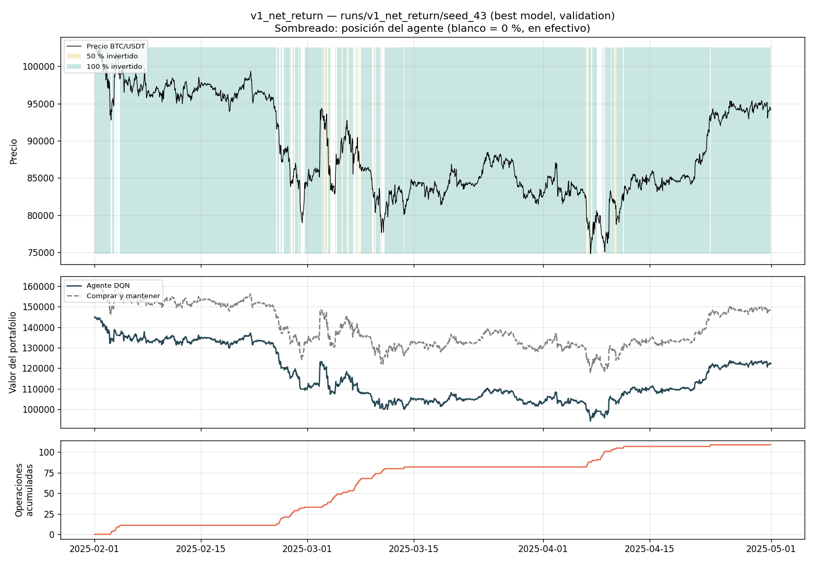
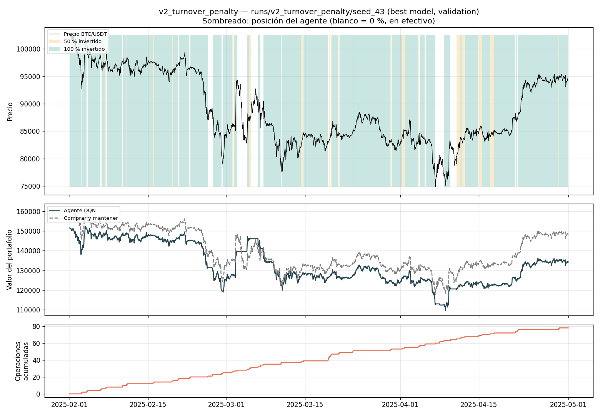
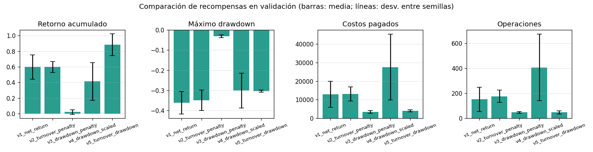
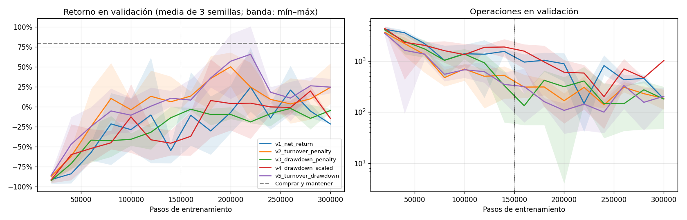
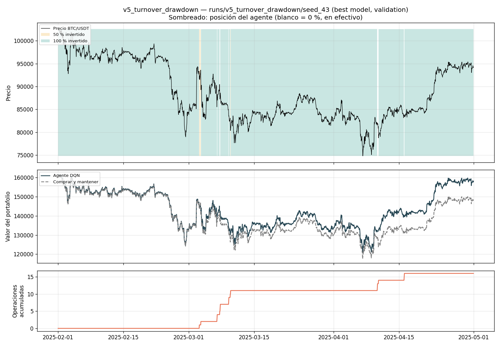
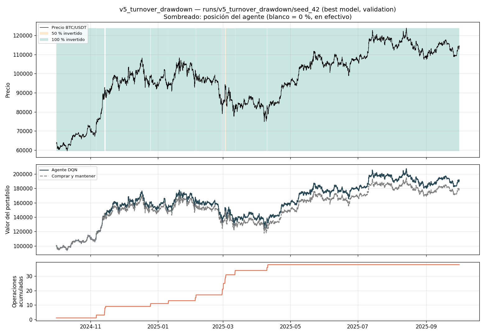

# Diseño e iteración de la función de recompensa

> Todas las versiones de la recompensa se
> entrenaron con la configuración final (`configs/dqn.toml`
> sin cambios), las mismas semillas (42, 43, 44) y el mismo protocolo, para comparar el efecto de la recompensa bajo un protocolo común. Todo se mide en
> validación (2024-10-01 a 2025-09-30). Esta sección compara únicamente validación; los resultados finales se presentan por separado.
> Como referencia, comprar y mantener obtiene en validación **+79,3 %** con un
> máximo drawdown de **−30,9 %**.

## 1. Cómo se diseñó la recompensa

La recompensa es el único canal por el que el agente sabe qué se espera de
él: DQN maximiza la suma descontada de recompensas, no el retorno del
portafolio ni su riesgo. Por eso cada término de la recompensa se eligió para
corregir un comportamiento concreto observado, siguiendo el ciclo del
enunciado (pasos 16 a 22):

| Paso | v1 → v2 / v3 (primera iteración) | v3 → v4 / v5 (segunda iteración) |
|---|---|---|
| 16. Recompensa | v1: retorno neto | v2: + penalización por operar; v3: + penalización por drawdown (λ = 1) |
| 17. Entrenamiento | 3 semillas, 300.000 pasos | igual |
| 18. Observación | ~97 % del tiempo invertido; operaciones concentradas en caídas | v3 se queda en efectivo el 99,5 % del tiempo |
| 19. Problema | no supera a comprar y mantener; *whipsaw*; más drawdown | escala de λ mal calibrada (≈ 25 veces el punto de equilibrio) |
| 20. Modificación | v2 y v3 | v4: λ escalado con datos de entrenamiento; v5: v2 + v4 |
| 21. Nuevo entrenamiento | 3 semillas | 3 semillas |
| 22. Comparación | sección 4 | sección 4 |

Las cinco versiones están en `src/rewards.py` y se prueban en
`tests/test_rewards.py`. Ninguna cambia el entorno: el portafolio siempre
paga el mismo costo real de 10 bps; las penalizaciones existen solo en la
señal de aprendizaje.

**Regla para los parámetros.** κ y λ se fijaron con razonamientos sobre el
periodo de **entrenamiento**, no probando valores en validación. Con cinco
versiones evaluadas en el mismo año de validación ya existe un sesgo de
selección (sección 6); buscar el mejor κ o λ en validación lo habría
agravado.

## 2. Primera iteración

### v1 — Retorno neto (punto de partida)

r_t = (V_(t+1) − V_t) / V_t

Es la recompensa más directa: sumar r_t a lo largo del episodio aproxima el
retorno acumulado, y como V_(t+1) ya descuenta el costo de transacción, operar
se castiga sin términos adicionales. El diagnóstico (Algoritmo y entrenamiento, sección 4.3)
mostró dos problemas:

1. **Riesgo sin compensación.** El agente pasa ~97 % del tiempo al 100 % y,
   aun así, tiene más drawdown que comprar y mantener (−36,2 % frente a
   −30,9 %) y menos retorno (+59,8 % frente a +79,3 %). Lo que hace distinto de
   comprar y mantener le resta valor.
2. **Whipsaw.** En la semilla 43, 109 de sus 226 operaciones (48 %) ocurren
   entre febrero y abril de 2025, el periodo de mayor caída y volatilidad:
   sale en medio de la caída, vuelve a entrar, paga costos y se pierde los
   rebotes.



La v1 trata igual una pérdida de 1 % en un máximo que una pérdida de 1 % que
lleva el portafolio a −30 %, y solo cobra 10 bps por una operación que además
arriesga perder el rebote. Las dos versiones siguientes atacan cada uno de
esos puntos.

### v2 — Penalización por operar (`v2_turnover_penalty`)

r_t = net_return_t − κ · |posición_t − posición_(t−1)|,  κ = 0,002

Ataca el problema 2 con un **costo sombra**: operar le "cuesta" al agente
30 bps en la recompensa (10 reales + 20 de penalización), aunque el portafolio
solo pague 10. La justificación de κ: el entorno no modela el spread ni el
deslizamiento, y una salida en plena caída tiene además el costo de perder el
rebote. 30 bps equivalen a ~0,7 veces el movimiento horario absoluto típico de
BTC en entrenamiento (0,42 %): suficiente para que el agente no opere por
movimientos de una hora, sin llegar a congelarlo en su posición inicial.

### v3 — Penalización por drawdown (`v3_drawdown_penalty`)

r_t = net_return_t − λ · max(0, DD_(t−1) − DD_t),  DD_t = V_t / máx V − 1 ≤ 0,  λ = 1

Ataca el problema 1. Solo se penaliza la **profundización** del drawdown: una
pérdida que lleva el portafolio más abajo de su máximo cuenta (1 + λ) veces,
mientras que las ganancias y las recuperaciones cuentan igual que en la v1.
Se prefirió esto a penalizar el nivel del drawdown en cada paso porque ese
diseño castiga al agente durante toda la recuperación por una caída que ya
ocurrió, y la suma de penalizaciones crecería con la duración del episodio.
λ = 1 ("una pérdida que profundiza la caída cuenta doble") se eligió por ser
fácil de interpretar y estar en el rango de la aversión a las pérdidas
estimada en finanzas conductuales (≈ 2).

## 3. Lo que se observó y la segunda iteración

### v2: menos operaciones y resultados más estables

Con el mejor checkpoint la v2 empata con la v1 (+59,9 % frente a +59,8 %),
pero con la mitad de dispersión entre semillas. La diferencia real aparece en
las medidas robustas (sección 4): en la segunda mitad del entrenamiento la v1
promedia −7,7 % y la v2 +21,3 %, con un tercio de las operaciones (244 frente a
707) y costos 2,6 veces menores. En febrero–abril de la semilla 43 pasa de 109
a 78 operaciones, pero todavía sale cerca de los mínimos (por ejemplo, a
inicios de abril) y se pierde parte del rebote.



### v3: el agente aprendió a no invertir (ejemplo de comportamiento anómalo)

Ver la sección 5.

### v4 y v5: λ calibrado con los datos de entrenamiento

La anomalía de la v3 es compatible con una escala excesiva de λ, y esa escala se puede calcular
**solo con el periodo de entrenamiento** (episodios de 1.024 horas, comprar y
mantener):

| Medida en entrenamiento | Valor |
|---|---|
| Retorno medio horario de estar 100 % invertido | +0,0074 % |
| Profundización media del drawdown por hora | 0,188 % |
| λ que iguala ambas (punto de equilibrio) | ≈ 0,039 |

Con λ = 1, la penalización esperada es ~25 veces la ganancia esperada de estar
invertido, lo que favorece una política conservadora. Este cálculo sobre comprar y mantener no demuestra que permanecer en efectivo sea la política óptima entre todas las posibles. Se corrigió así:

- **v4 (`v4_drawdown_scaled`)**: la misma fórmula con λ = 0,02, la mitad del
  punto de equilibrio. Estar invertido sigue teniendo recompensa esperada
  positiva, pero las caídas pesan más.
- **v5 (`v5_turnover_drawdown`)**: combina la v2 (la mejor de la primera
  iteración) con la v4.

  r_t = net_return_t − 0,002 · turnover_t − 0,02 · max(0, DD_(t−1) − DD_t)

## 4. Comparación de las cinco versiones

### 4.1 Mejor checkpoint

Tabla generada con `python -m src.analysis compare ...`
(`runs/comparison/reward_comparison.md`). Media ± desviación entre 3 semillas,
validación.

| Métrica | v1 | v2 | v3 | v4 | v5 | Comprar y mantener |
|---|---|---|---|---|---|---|
| Retorno acumulado | +59,8 % ± 15,6 % | +59,9 % ± 7,1 % | +2,2 % ± 3,0 % | +41,4 % ± 24,0 % | **+88,3 % ± 13,9 %** | +79,3 % |
| Máximo drawdown | −36,2 % ± 5,6 % | −34,9 % ± 5,0 % | −3,1 % ± 0,7 % | −30,1 % ± 8,6 % | −30,4 % ± 0,4 % | −30,9 % |
| Costos pagados | 12.935 | 13.172 | 3.451 | 27.546 | **3.986** | 100 |
| Operaciones | 152 ± 98 | 177 ± 50 | 48 ± 7 | 408 ± 267 | **48 ± 13** | 1 |
| % tiempo 0 / 50 / 100 % | 1 / 1 / 98 | 2 / 4 / 94 | 99 / 0 / 0 | 1 / 33 / 66 | 1 / 1 / 98 | 0 / 0 / 100 |



### 4.2 Medidas robustas

El mejor checkpoint es el máximo de ~15 evaluaciones ruidosas de validación
(Algoritmo y entrenamiento, sección 4.2), así que es optimista. Por eso la elección se basa
en las medidas que no dependen de quedarse con el pico
(`python -m src.reward_report`, `runs/comparison/reward_robust.md`):

| Recompensa | Último checkpoint | Promedio 2.ª mitad | Drawdown 2.ª mitad | Operaciones 2.ª mitad | Costos 2.ª mitad | Evaluaciones > comprar y mantener |
|---|---|---|---|---|---|---|
| v1 | −4,6 % ± 14,6 % | −7,7 % ± 17,3 % | −37,9 % | 707 | 38.938 | 0 de 41 |
| v2 | +24,2 % ± 26,6 % | +21,3 % ± 4,0 % | −28,3 % | 244 | 14.703 | 0 de 45 |
| v3 | −12,5 % ± 13,7 % | −9,3 % ± 5,6 % | −17,0 % | 257 | 13.501 | 0 de 44 |
| v4 | −22,9 % ± 14,7 % | −5,2 % ± 16,2 % | −36,5 % | 797 | 45.725 | 0 de 41 |
| **v5** | **+24,6 % ± 9,5 %** | **+30,9 % ± 8,7 %** | **−25,3 %** | **190** | **11.551** | **2 de 45** |

*«2.ª mitad»: promedio de las evaluaciones desde el paso 150.000.*



### 4.3 Interpretación: qué comportamiento induce cada recompensa

- **v1 (retorno neto)** induce "quedarse invertido y reaccionar a las
  caídas". Es la versión más inestable: el retorno salta entre evaluaciones
  consecutivas y opera mucho durante el entrenamiento.
- **v2 (penalizar operar)** cumple su objetivo: reduce las operaciones y los
  costos a un tercio y estabiliza el aprendizaje, sin cambiar cuánto tiempo
  pasa invertido. No resuelve las salidas cerca de los mínimos.
- **v3 (drawdown, λ = 1)** induce no participar en el mercado: tiene el menor
  drawdown, pero porque casi no invierte (sección 5).
- **v4 (drawdown, λ = 0,02)** no resultó mejor que la v1: opera todavía más
  (797 operaciones en la 2.ª mitad) y las semillas aprenden políticas muy
  distintas (la 42 pasa el 91 % del tiempo al 50 %, la 44 el 98 % al 100 %).
  Una penalización por drawdown, por sí sola, empuja a salir en las caídas,
  que es justo el *whipsaw* que se quería evitar. Este resultado confirma lo
  que el análisis del entrenamiento anticipaba: penalizar el riesgo tiene el
  costo de quedarse fuera de los rebotes.
- **v5 (ambas penalizaciones)** es la única que mejora todas las medidas a la
  vez frente a la v1 (la v3 tiene menos drawdown, pero porque no invierte). Las dos penalizaciones se complementan: la de drawdown le da al agente
  una razón para reducir la exposición en caídas fuertes, y la de operar
  desincentiva reaccionar a cada movimiento de una hora. En febrero–abril de la
  semilla 43 hace 16 operaciones (la v1, 109), atraviesa la caída casi siempre
  invertida y termina por encima de comprar y mantener en ese tramo.



**Lectura honesta.** Ninguna versión supera de forma confiable a comprar y
mantener en validación. La v5 lo supera en el mejor checkpoint (+88,3 % frente
a +79,3 %), pero solo en 2 de sus 45 evaluaciones; su desempeño típico en la
segunda mitad del entrenamiento es +30,9 %. En un año en que BTC subió 79 %, el
estándar es alto, y el aporte real de la iteración fue sobre todo **reducir el
riesgo, los costos y la variabilidad**, no superar a la estrategia pasiva.

## 5. Ejemplo de comportamiento inesperado: la v3 deja de invertir


**Qué pasó.** Con la v3 las tres semillas aprendieron a estar en efectivo
entre el 99,4 % y el 99,6 % del año de validación. El "mejor" checkpoint de la
semilla 43 termina en +4,8 % con un drawdown de solo −2,9 %, frente al +79,3 %
del mercado.

**Por qué es reward hacking.** La recompensa se diseñó para que el agente
evitara el riesgo *mientras invierte*, pero encontró una forma más barata de
maximizarla: no invertir. Estar en efectivo da recompensa 0 en cada paso, y
estar invertido da, en promedio, +0,0074 % − 1 × 0,188 % < 0 por hora. Para el
agente, la recompensa esperada de comprar y mantener es negativa, así que
optimiza correctamente una función que no representa el objetivo financiero.
El error no fue del algoritmo sino de la escala de λ, y se podía detectar
antes de entrenar con un cálculo sobre los datos de entrenamiento (sección 3).

**Un detalle que no se explica del todo.** Las pocas veces que la v3 entra al
mercado (43 operaciones, unas 35 horas en total) lo hace por una o dos horas,
y en esas horas el activo sube en promedio +0,32 %, unas 40 veces el promedio
del año. Parece que el agente solo invierte cuando espera un movimiento muy
grande. Sin embargo, la muestra es pequeña y sus valores Q para las tres
acciones son casi idénticos (≈ 0,08), así que la decisión depende de
diferencias mínimas en Q: puede ser una señal real o simple ruido. Además, un Q positivo para la acción de estar en efectivo no prueba sobreestimación: representa la recompensa futura descontada, incluida la posibilidad de invertir en pasos posteriores. Distinguir una oportunidad aprendida de ruido requiere más observaciones y un análisis adicional. Double DQN sería una alternativa para estudiar el sesgo de sobreestimación, no una explicación comprobada de este caso.

## 6. Limitaciones

- **Sesgo de selección en validación.** Se compararon cinco recompensas en el
  mismo año de validación, y la v4 y la v5 se diseñaron después de ver los
  resultados de la v2 y la v3. Aunque κ y λ no se buscaron en validación, el
  retorno de validación de la versión elegida sigue siendo optimista; la
  estimación honesta será la del held-out. Por esto se detuvo la iteración en
  la v5.
- **El checkpoint se elige por retorno, no por la recompensa.** El protocolo
  (`selection.metric = "total_return"`) se mantuvo igual para todas las
  versiones, pero eso significa que la selección del checkpoint favorece
  retorno aunque la recompensa penalice riesgo, y diluye en parte el efecto de
  la v3, la v4 y la v5. Se podría seleccionar por Calmar (retorno / drawdown).
- **Un solo año de validación alcista.** En un año en que comprar y mantener
  gana 79 %, cualquier política que reduzca exposición se ve penalizada. Las
  conclusiones podrían ser distintas en un año bajista (no-estacionariedad).
- **Parámetros sin barrido.** No se exploraron otros κ y λ. Con un solo valor
  por versión no se puede saber si existen valores mucho mejores; se prefirió
  así para no sobreajustar la validación.
- **El drawdown se mide por episodio.** En entrenamiento el máximo se reinicia
  cada 1.024 horas, por lo que la v3/v4/v5 penalizan caídas desde el máximo
  del episodio, no desde el máximo histórico.

## 7. Recomendación para el agente final

Se recomienda **v5_turnover_drawdown** como recompensa final: es la mejor en el
mejor checkpoint y, sobre todo, en las medidas robustas: tiene el mejor último
checkpoint, el mejor promedio de la segunda mitad, las menos operaciones y los
menores costos, y el menor drawdown entre las versiones que sí invierten (la v3
tiene menos, pero porque se queda en efectivo). También es la de menor
dispersión entre semillas en drawdown.

Para no elegir la semilla con el resultado más alto (otro máximo optimista), se
propone congelar la **semilla de resultado mediano, la 42** (+91,0 %, −29,9 % de
drawdown, 38 operaciones en validación); la 43 obtuvo +100,6 % y la 44
+73,2 %. La selección se establece antes de la evaluación en
held-out:

```bash
python -m src.train --freeze runs/v5_turnover_drawdown/seed_42
```



## 8. Cómo reproducir esta sección

```bash
# Entrenar cada versión (3 semillas cada una, ~15 min en CPU por versión)
python -m src.train --reward v2_turnover_penalty
python -m src.train --reward v3_drawdown_penalty
python -m src.train --reward v4_drawdown_scaled
python -m src.train --reward v5_turnover_drawdown

# Tablas de comparación (mejor checkpoint y medidas robustas)
python -m src.analysis compare v1_net_return v2_turnover_penalty v3_drawdown_penalty v4_drawdown_scaled v5_turnover_drawdown
python -m src.reward_report

# Gráficos de comportamiento usados en esta sección
python -m src.analysis inspect runs/v1_net_return/seed_43 --start 2025-02-01 --end 2025-05-01
python -m src.analysis inspect runs/v2_turnover_penalty/seed_43 --start 2025-02-01 --end 2025-05-01
python -m src.analysis inspect runs/v5_turnover_drawdown/seed_43 --start 2025-02-01 --end 2025-05-01
python -m src.analysis inspect runs/v3_drawdown_penalty/seed_43
python -m src.analysis inspect runs/v5_turnover_drawdown/seed_42

# Pruebas de las recompensas
python -m pytest tests/test_rewards.py
```

Con las versiones fijadas y la misma máquina, los resultados son idénticos: la
v1 se reentrenó como control y reprodujo exactamente las evaluaciones de la
corrida de referencia.

## Referencias

- Kahneman, D., y Tversky, A. (1979). Prospect theory: An analysis of decision under risk. *Econometrica*, 47(2), 263–291.
- Sutton, R. S., y Barto, A. G. (2018). *Reinforcement learning: An introduction* (2.ª ed.). MIT Press.
- van Hasselt, H., Guez, A., y Silver, D. (2016). Deep reinforcement learning with double Q-learning. *Proceedings of the AAAI Conference on Artificial Intelligence*, 30(1).
