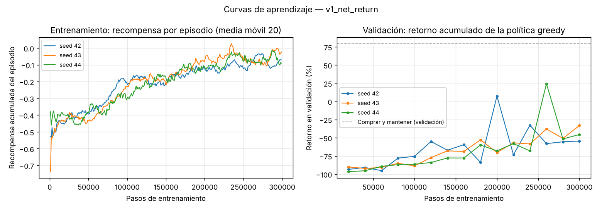
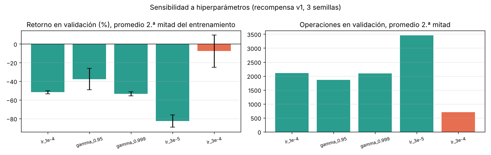
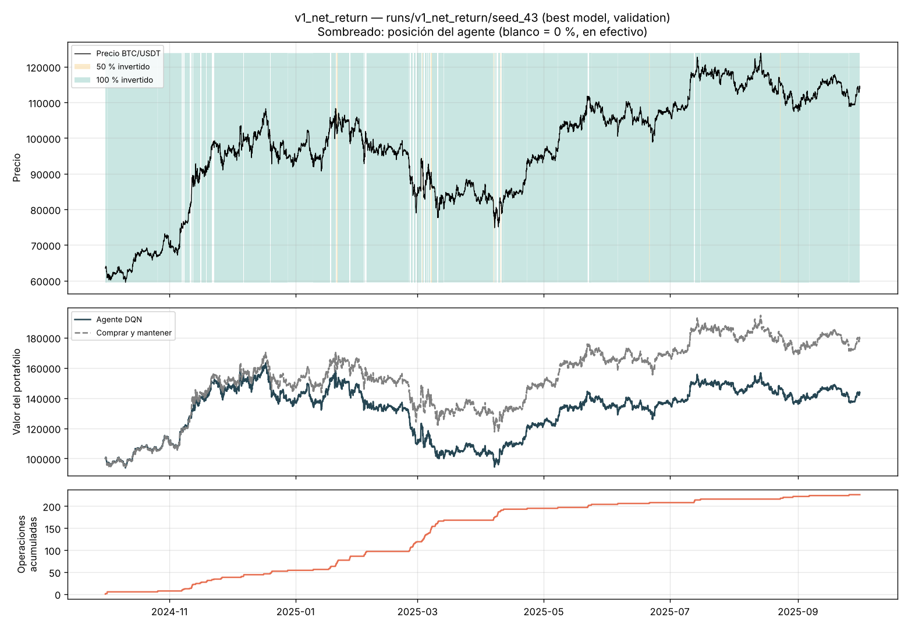

# Persona 4 — Algoritmo, hiperparámetros y protocolo de entrenamiento

> Secciones del informe a cargo de la Persona 4. Todos los resultados son de
> la recompensa v1 (`v1_net_return`) y se miden en **validación**; el held-out
> no se ha usado. Los resultados de las versiones siguientes de la recompensa
> se reportan en la sección de la Persona 5, entrenadas con esta misma
> configuración final.

## 1. Algoritmo utilizado

Se utilizó **Deep Q-Network (DQN)** (Mnih et al., 2015) en la implementación de
Stable-Baselines3. DQN aproxima la función de valor de acción Q(s, a) con una
red neuronal y actúa de forma greedy respecto a ella; la política no se
representa explícitamente sino que se deriva de Q:

π(s) = argmax_a Q(s, a; θ)

La red se entrena minimizando el error de diferencia temporal (TD) contra un
objetivo calculado con una copia congelada de la red (red objetivo θ⁻):

y = r + γ · max_a' Q(s', a'; θ⁻)

Es la extensión con aproximación de funciones del Q-learning tabular
(Sutton y Barto, 2018, cap. 6.5 y 16.5). Las dos piezas que la estabilizan son
el *replay buffer* (rompe la correlación temporal entre transiciones
consecutivas, que en una serie de precios es muy fuerte) y la red objetivo
(evita que el objetivo se mueva en cada actualización).

**Por qué DQN y no PPO.** El espacio de acciones es discreto y pequeño
(A = {0 %, 50 %, 100 %}), que es el caso para el que DQN fue diseñado: produce
un valor Q por acción y elegir la mejor es un argmax. Además DQN es
*off-policy*: reutiliza muchas veces cada transición guardada en el buffer, lo
que aprovecha mejor una serie histórica de tamaño fijo. PPO
(Schulman et al., 2017) también es válido con acciones discretas y suele ser
más estable, pero es *on-policy* (descarta los datos tras cada actualización) y
no aporta una ventaja clara en un problema con solo tres acciones. Queda como
alternativa si DQN resulta inestable entre semillas.

## 2. Arquitectura e hiperparámetros

Todos los valores están en `configs/dqn.toml`; `src/train.py` no contiene
hiperparámetros en el código y copia la configuración efectiva a cada corrida
(`config.json`).

| Hiperparámetro | Valor | Justificación |
|---|---|---|
| Algoritmo | DQN (Stable-Baselines3 2.9.0) | Acciones discretas; off-policy |
| Arquitectura de la red | MLP 7 → 64 → 64 → 3, ReLU | 6 indicadores + posición actual de entrada; un valor Q por acción. Red pequeña porque la entrada es de baja dimensión y la señal es ruidosa (una red grande sobreajusta) |
| Learning rate | 3 × 10⁻⁴ (Adam) | Elegido con validación entre 3 × 10⁻⁵, 1 × 10⁻⁴ y 3 × 10⁻⁴ (sección 4.2). Se partió de 1 × 10⁻⁴, valor habitual en DQN, pero con él el agente quedaba subentrenado en 300.000 pasos |
| Batch size | 64 | Estándar; compromiso entre ruido del gradiente y costo |
| Factor de descuento γ | 0,99 | Horizonte efectivo 1/(1−γ) ≈ 100 horas (~4 días): suficiente para que el agente "vea" el efecto de pagar un costo hoy frente al movimiento de los días siguientes |
| Replay buffer | 100.000 transiciones | ≈ 2,4 veces el periodo de entrenamiento (41.467 horas): cubre varios regímenes de mercado |
| Pasos antes de aprender | 5.000 | El buffer se llena primero con experiencia aleatoria |
| Frecuencia de entrenamiento | 1 actualización cada 4 pasos | Estándar de DQN |
| Actualización de la red objetivo | cada 2.000 pasos (copia dura) | Estabiliza el objetivo TD |
| Recorte del gradiente | norma máxima 10 | Valor por defecto de SB3 |
| Exploración | ε-greedy con decaimiento lineal | |
| ε inicial / final | 1,0 / 0,05 | |
| Fracción de decaimiento de ε | 30 % del entrenamiento (90.000 pasos) | |
| Pasos de entrenamiento | 300.000 como máximo | ≈ 7 recorridos del periodo de entrenamiento |
| Longitud de episodio (entrenamiento) | 1.024 horas (~43 días), inicio aleatorio | Episodios cortos y variados en vez de recorrer siempre la misma serie desde el inicio |
| Criterio de parada | 300.000 pasos o 6 evaluaciones de validación seguidas sin mejora (early stopping) | |
| Selección del checkpoint | mejor retorno acumulado en **validación** | Ver sección 3 |
| Semillas | 42, 43, 44 | Al menos tres para medir la variabilidad |
| Capital inicial / costo | 100.000 / 10 bps por unidad negociada | Acuerdos del equipo; iguales a los baselines |

## 3. Protocolo de entrenamiento

1. **Separación temporal.** Entrenamiento: 2020-01-08 a 2024-09-30
   (41.467 horas útiles tras el calentamiento de los indicadores). Validación:
   2024-10-01 a 2025-09-30 (8.760 horas). El held-out (2025-10-01 a
   2026-09-30) **no se construye en `train.py`**: la función que arma los
   entornos lo descarta explícitamente y una prueba automática
   (`tests/test_agent.py`) verifica que el último dato visto durante el
   entrenamiento es anterior al inicio del held-out.
2. **Entrenamiento.** Episodios de 1.024 horas que empiezan en una vela
   aleatoria del periodo de entrenamiento. El agente siempre arranca en
   efectivo (posición 0).
3. **Evaluación periódica en validación.** Cada 20.000 pasos se recorre la
   validación completa con la política greedy (ε = 0) y se registran retorno
   acumulado, máximo drawdown, costos, número de operaciones y porcentaje de
   tiempo en cada posición (`validation_log.csv`). Si el retorno de validación
   mejora, se guarda el checkpoint (`best_model.zip`).
4. **Parada.** Al llegar a 300.000 pasos o tras 6 evaluaciones sin mejora.
5. **Repetición con 3 semillas** y reporte de media y desviación estándar
   entre semillas (`summary.csv`), no solo la mejor corrida.
6. **Congelamiento.** El agente final se elige con validación y se congela
   (`python -m src.train --freeze ...`), lo que guarda el modelo, su
   configuración, el commit y un hash del archivo del modelo en
   `models/final/`. Desde ese momento no se reentrena ni se ajusta nada, y la
   Persona 6 lo evalúa una sola vez en el held-out.

**Reproducibilidad.** `set_global_seed` fija las semillas de Python, NumPy y
PyTorch, limita PyTorch a un hilo y activa algoritmos deterministas;
Stable-Baselines3 recibe la misma semilla para la exploración y el entorno la
usa para los inicios aleatorios. Se verificó que dos corridas con la misma
semilla producen pesos idénticos. Cada corrida guarda el commit de git, las
versiones de las librerías y el hash SHA-256 del dataset (`metadata.json`).

**Limitación del protocolo.** Seleccionar el checkpoint con la validación
convierte a la validación en parte del proceso de ajuste: el retorno de
validación del mejor checkpoint es optimista. Por eso la estimación honesta del
desempeño es la del held-out, que se usa una sola vez.

## 4. Resultados del entrenamiento con la recompensa v1

Todas las cifras son del periodo de **validación** (2024-10-01 a 2025-09-30,
capital inicial 100.000, costo 10 bps). Como referencia, comprar y mantener en
ese periodo obtiene **+79,3 %** con un máximo drawdown de **−30,9 %**: fue un
año alcista para BTC.

### 4.1 Configuración inicial (learning rate 1 × 10⁻⁴)

| Semilla | Mejor checkpoint | Retorno | Máx. drawdown | Costos | Operaciones | % tiempo en 0 / 50 / 100 % |
|---|---|---|---|---|---|---|
| 42 | paso 200.000 | +7,4 % | −42,9 % | 66.112 | 1.084 | 1 / 10 / 89 |
| 43 | paso 300.000 | −33,1 % | −51,4 % | 93.326 | 1.912 | 3 / 38 / 60 |
| 44 | paso 260.000 | +24,3 % | −36,8 % | 40.534 | 521 | 1 / 5 / 94 |
| **Media ± desv.** | | **−0,5 % ± 29,5 %** | **−43,7 %** | **66.657** | **1.172** | |

El agente mejoró durante el entrenamiento, pero **operaba en exceso**: al
inicio cambiaba de posición en casi la mitad de las horas (3.800 a 5.300
operaciones por año) y al final todavía hacía 1.300 a 1.900, con lo que pagaba
en costos entre el 40 % y el 93 % del capital inicial. La recompensa por
episodio seguía subiendo a los 300.000 pasos, es decir, el entrenamiento no
había convergido. Con solo esta configuración era tentador concluir que el
problema era la recompensa; el estudio de la sección 4.2 muestra que gran
parte era subentrenamiento.

### 4.2 Sensibilidad a hiperparámetros

Se cambió **un hiperparámetro a la vez** respecto a la configuración inicial
(γ y learning rate, los dos con más efecto esperado en DQN), con la misma
recompensa, las mismas 3 semillas y el mismo protocolo. Todo se midió en
validación (`python -m src.sensitivity run`).

| Variante | Promedio 2.ª mitad del entrenamiento | Último checkpoint | Operaciones (2.ª mitad) | Mejor checkpoint (optimista) |
|---|---|---|---|---|
| Inicial: γ = 0,99, lr = 1 × 10⁻⁴ | −51,8 % ± 1,6 % | −44,4 % | 2.107 | −0,5 % ± 29,5 % |
| γ = 0,95 (horizonte ~20 h) | −37,7 % ± 11,4 % | −31,2 % | 1.856 | +9,3 % ± 33,7 % |
| γ = 0,999 (horizonte ~1.000 h) | −53,5 % ± 2,2 % | −42,5 % | 2.089 | −18,7 % ± 2,5 % |
| lr = 3 × 10⁻⁵ | −82,6 % ± 6,7 % | −81,6 % | 3.459 | −74,5 % ± 11,7 % |
| **lr = 3 × 10⁻⁴ (elegida)** | **−7,7 % ± 17,3 %** | **−4,6 %** | **707** | **+59,8 % ± 15,6 %** |

*Media ± desviación entre 3 semillas. «Promedio 2.ª mitad»: promedio de las
evaluaciones de validación desde el paso 150.000.*

**Interpretación.**

- **El learning rate es el hiperparámetro dominante.** El orden de las tres
  tasas es el mismo en todas las medidas: con 3 × 10⁻⁵ el agente casi no
  aprende y opera aún más; con 3 × 10⁻⁴ opera tres veces menos que con la
  inicial y pierde mucho menos. Esto confirma que el exceso de operaciones de
  la sección 4.1 se debía en gran parte a que **el agente no había terminado
  de aprender** que operar cuesta, y no solo al diseño de la recompensa.
- **γ tiene un efecto menor.** Un horizonte corto (γ = 0,95) mejora algo, pero
  con más variabilidad entre semillas. Un horizonte muy largo (γ = 0,999) no
  ayuda, aunque las semillas se parecen más entre sí.
- **El mejor checkpoint es una medida optimista.** El retorno de validación
  salta mucho de una evaluación a la siguiente (con lr = 3 × 10⁻⁴, de −70 % a
  +62 % entre evaluaciones consecutivas de la misma semilla), y el mejor
  checkpoint es el máximo de unas 15 evaluaciones ruidosas. Por eso la
  variante elegida «gana» +59,8 % en la última columna pero solo −7,7 % en
  promedio. **La elección se hizo con las medidas robustas** (promedio de la
  segunda mitad y último checkpoint), no con el pico.
- **Decisión:** se adopta lr = 3 × 10⁻⁴ y se mantiene γ = 0,99. No se combinó
  lr = 3 × 10⁻⁴ con γ = 0,95 para no seguir afinando contra la validación con
  tan pocas evaluaciones; queda como limitación.

### 4.3 Configuración final (learning rate 3 × 10⁻⁴)

Con la configuración final se reentrenó la v1 (`runs/v1_net_return/`). Los
resultados coinciden exactamente con la variante lr = 3 × 10⁻⁴ del estudio, lo
que confirma de nuevo la reproducibilidad. Dos semillas activaron el early
stopping (pasos 240.000 y 280.000).

| Semilla | Mejor checkpoint | Retorno | Máx. drawdown | Costos | Operaciones | % tiempo en 0 / 50 / 100 % |
|---|---|---|---|---|---|---|
| 42 | paso 120.000 | +61,7 % | −31,1 % | 15.318 | 190 | 1 / 2 / 97 |
| 43 | paso 160.000 | +43,4 % | −42,2 % | 18.442 | 226 | 2 / 2 / 96 |
| 44 | paso 220.000 | +74,3 % | −35,2 % | 5.046 | 41 | 1 / 0 / 99 |
| **Media ± desv.** | | **+59,8 % ± 15,6 %** | **−36,2 % ± 5,6 %** | **12.935** | **152** | |
| *Comprar y mantener* | | *+79,3 %* | *−30,9 %* | *100* | *1* | *0 / 0 / 100* |

**Interpretación.**

- **El agente aprendió, sobre todo, a quedarse invertido.** Pasa entre el
  96 % y el 99 % del tiempo al 100 %, y su retorno viene casi entero de
  acompañar la subida del año. En un año alcista esa es una política
  razonable, pero significa que el agente **se parece a comprar y mantener**.
- **Ninguna semilla supera a comprar y mantener**, ni en retorno ni en
  drawdown, incluso midiendo en el mejor checkpoint (que es optimista).
  Lo que el agente hace distinto de comprar y mantener le resta valor.
- **Las operaciones que quedan se concentran en las caídas.** En la semilla 43,
  109 de sus 226 operaciones (48 %) ocurren entre febrero y abril de 2025,
  el periodo de mayor caída y volatilidad de la validación. El agente sale y
  entra del mercado justo cuando el precio se mueve con más fuerza, paga
  costos y se pierde parte de los rebotes; ese capital no lo recupera
  después. Es un buen candidato para el ejemplo de comportamiento inesperado
  del informe (Persona 5).

### 4.4 Implicaciones para la siguiente iteración

1. Las versiones siguientes de la recompensa se deben entrenar con esta
   configuración final, sin cambiar hiperparámetros, para que la diferencia
   se pueda atribuir a la recompensa (`python -m src.analysis compare` avisa
   si el protocolo difiere).
2. El problema pendiente ya no es tanto el exceso de operaciones como las
   **salidas y entradas durante la alta volatilidad**. Una recompensa que
   penalice el riesgo (drawdown o volatilidad) o el cambio de posición puede
   atacarlo, a costa de quedarse fuera de los rebotes.
3. Al comparar versiones conviene mirar también el último checkpoint y el
   promedio de las evaluaciones, no solo el mejor checkpoint, por el sesgo
   descrito en la sección 4.2.

Archivos de respaldo: `runs/v1_net_return/` (configuración final),
`runs/sensitivity/` (estudio de sensibilidad, incluida la configuración
inicial en `runs/sensitivity/lr_1e-4/`) y `runs/sensitivity/sensitivity.md`.

## Referencias

- Mnih, V., et al. (2015). Human-level control through deep reinforcement learning. *Nature*, 518, 529–533.
- Raffin, A., et al. (2021). Stable-Baselines3: Reliable reinforcement learning implementations. *JMLR*, 22(268), 1–8.
- Schulman, J., et al. (2017). Proximal policy optimization algorithms. arXiv:1707.06347.
- Sutton, R. S., y Barto, A. G. (2018). *Reinforcement learning: An introduction* (2.ª ed.). MIT Press.
